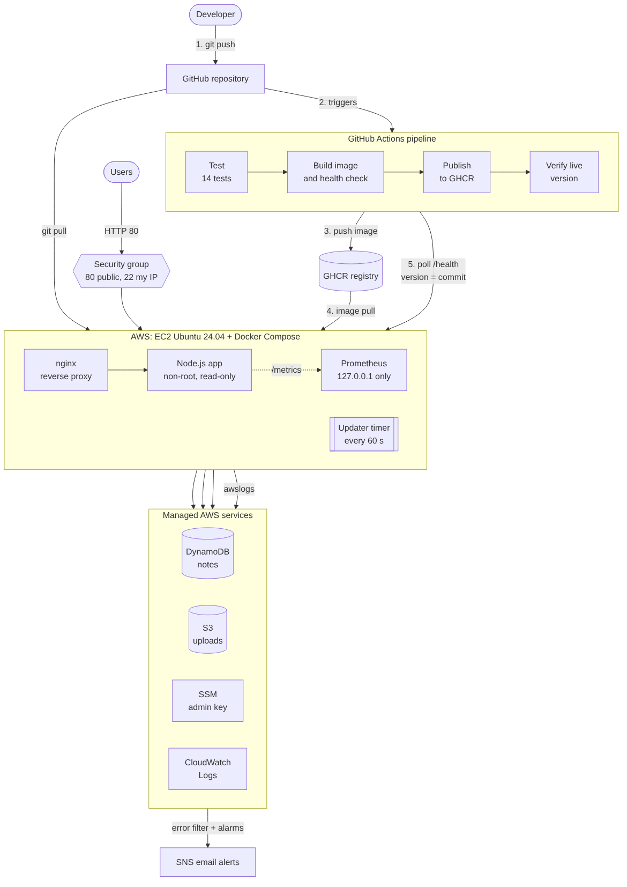

# Cloud & DevOps Capstone: Cloud Notes

Codomax Digital Solutions internship, Module 6 (Day 26 to Day 30).
Author: Foncho Afanwi Ngwa ([@fonchoafa](https://github.com/fonchoafa))

A real web app (Node.js REST API + web page) built, containerized, deployed to AWS with Terraform, shipped by a CI/CD pipeline and monitored.

**Live website:** http://LIVE-IP-HERE (health: http://LIVE-IP-HERE/health)
The site uses plain HTTP (no domain or TLS certificate), so browsers show "Not secure".



## Requirements and where they are implemented

| Capstone requirement | Implementation |
| --- | --- |
| Cloud infrastructure | [terraform/](terraform/): EC2, Elastic IP, security group, IAM role, S3, DynamoDB, CloudWatch, SNS, Budget |
| Git | Branch + pull request workflow, PR template, Dependabot |
| Docker | [app/Dockerfile](app/Dockerfile) multi-stage, non-root, health check; [deploy/docker-compose.yml](deploy/docker-compose.yml) |
| CI/CD pipeline | [.github/workflows/ci-cd.yml](.github/workflows/ci-cd.yml): test, build, publish to GHCR, verify live version |
| Active monitoring | Prometheus + alert rules, CloudWatch Logs, metric filter alarm, CPU/status alarms, SNS email |
| Managed database / auth | DynamoDB (point-in-time recovery); admin key in SSM Parameter Store protects `DELETE` |
| Architecture diagram | [docs/architecture.png](docs/architecture.png) |

## Repo map
| Path | Content |
| --- | --- |
| [app/](app/) | Express app, front end, 14 tests (`npm test`) |
| [deploy/](deploy/) | Production Compose file and nginx config used on the server |
| [terraform/](terraform/) | All AWS infrastructure |
| [monitoring/](monitoring/) | Prometheus config and alert rules |
| [docs/](docs/) | [Architecture](docs/01-architecture.md), [Deployment guide](docs/02-deployment-guide.md), [CI/CD and monitoring](docs/03-ci-cd-and-monitoring.md) |
| [scripts/](scripts/) | `smoke-test.ps1` for the live URL, `monitor.ps1` for local metrics |
| [screenshots/](screenshots/) | Evidence |

## Run locally
```powershell
copy .env.example .env      # set ADMIN_KEY
docker compose up -d --build
```
Open http://localhost:8080 (app) and http://localhost:9090 (Prometheus). `docker compose down` to stop.

## Deploy
See [docs/02-deployment-guide.md](docs/02-deployment-guide.md). Short version: push, wait for the image, `terraform apply`, set the `LIVE_URL` variable.

## Security notes
- No secrets in Git (`.env`, `terraform.tfvars`, state are ignored); no AWS keys on the server (IAM role).
- Pipeline holds no deploy credentials (pull-based deploy).
- Only port 80 is public; `/metrics` is blocked at nginx; Prometheus is reachable only through SSH.
- Container: non-root, read-only filesystem, capabilities dropped, memory and CPU limits.

## Lessons learned
_(Write 4 to 5 honest lines from your own run: what broke, how you fixed it, what you would add next.)_

## Evidence
| Check | Screenshot |
| --- | --- |
| Pipeline green with live verification | [01-actions-green.png](screenshots/01-actions-green.png) |
| Public image in GHCR | [02-ghcr-package.png](screenshots/02-ghcr-package.png) |
| Terraform apply | [03-terraform-apply.png](screenshots/03-terraform-apply.png) |
| Live site | [04-live-site.png](screenshots/04-live-site.png) |
| Health shows deployed commit | [05-health.png](screenshots/05-health.png) |
| Smoke test | [06-smoke-test.png](screenshots/06-smoke-test.png) |
| Containers on the server | [07-docker-ps.png](screenshots/07-docker-ps.png) |
| Prometheus targets | [08-prometheus.png](screenshots/08-prometheus.png) |
| CloudWatch logs | [09-cloudwatch-logs.png](screenshots/09-cloudwatch-logs.png) |
| CloudWatch alarms | [10-cloudwatch-alarms.png](screenshots/10-cloudwatch-alarms.png) |

## Clean up
`terraform destroy` in `terraform/` once the module is reviewed.
