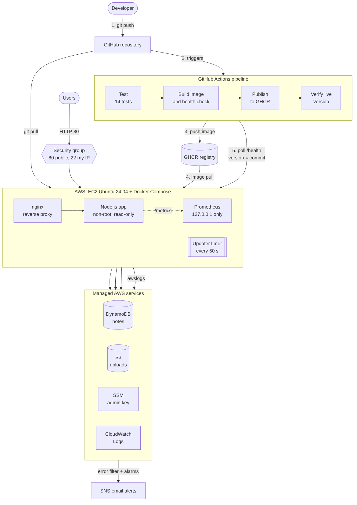

# Architecture

Source of the diagram: [architecture.mmd](architecture.mmd) (Mermaid).

## How a change reaches production

1. I push to `main`.
2. GitHub Actions runs the tests, builds the Docker image, starts it and checks `/health`.
3. The image is published to GHCR, tagged `latest` and with the short commit id (for example `a1b2c3d`). The same id is baked into the image as `APP_VERSION`.
4. A systemd timer on the EC2 server runs every 60 seconds: `git pull`, `docker compose pull`, `docker compose up -d`. Only containers whose image changed are restarted.
5. The last pipeline job polls `http://<live>/health` until the reported `version` equals the commit id, then runs smoke checks. If the server never reaches that version, the pipeline fails.

I chose a **pull-based** deploy on purpose: the pipeline never holds SSH keys or AWS credentials, so a leaked pipeline secret cannot reach the server.

## Components

| Layer | Choice | Why |
| --- | --- | --- |
| Cloud infrastructure | AWS, created by Terraform | Repeatable, reviewable, one command to destroy |
| Compute | EC2 t3.micro, Elastic IP, Docker Compose | Cheap, fixed address for the live URL |
| Reverse proxy | nginx | Only public container; blocks `/metrics` |
| Application | Node.js 22 / Express 5 | REST API + web page (Cloud Notes) |
| Managed database | DynamoDB (on-demand, point-in-time recovery) | No servers to patch, managed backups |
| Object storage | S3 (private, encrypted, 30-day expiry) | Attachments |
| Auth / secrets | SSM Parameter Store SecureString + IAM role | Admin key protects `DELETE`; no keys on the server |
| Containers | Multi-stage Dockerfile, non-root, read-only, caps dropped | Small, safer image |
| CI/CD | GitHub Actions, GHCR | Test, build, publish, verify |
| Monitoring | Prometheus, CloudWatch Logs/metrics/alarms, SNS | See [03-ci-cd-and-monitoring.md](03-ci-cd-and-monitoring.md) |

## Security boundaries

- Security group: port 80 public, port 22 only from my IP. Ports 3000 and 9090 are not open.
- Prometheus is bound to `127.0.0.1` and reached with an SSH tunnel.
- IAM role grants only the one table, one bucket and one parameter.
- IMDSv2 required (hop limit 2 so containers can still get role credentials).
- Disk and bucket encrypted; bucket blocks public access.
